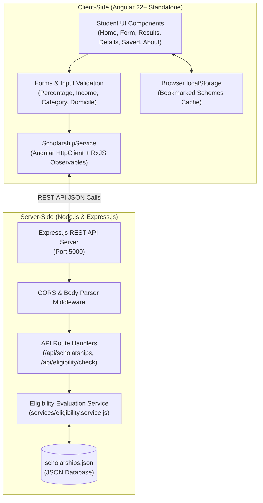

# Scholarship Eligibility Portal

A full-stack, responsive web application engineered to match higher education students with suitable government, state, philanthropic, and institutional scholarship schemes based on individual multi-factor eligibility criteria (academic percentage, annual family income, education level, state domicile, and reserved category quotas).

> 🎓 **Academic Project Notice:** This application is developed for educational and college project demonstration purposes. All eligibility evaluations are simulated decision-support assessments. Official awards are granted solely by the respective government awarding authorities or administering trusts.

---

## 1. Project Overview & Architecture



### Key Capabilities
- **Multi-Factor Relational Evaluation:** Compares student's marks, income ceiling, level of study, domicile, and quota against scholarship rules.
- **Three-Tier Match Classification:**
  - `Meets Listed Criteria`: 100% satisfied across all configured parameters.
  - `May Be Eligible`: Near threshold (within 3% tolerance) or requires institutional verification/relaxation.
  - `Not Eligible Under Listed Rules`: Fails one or more mandatory conditions (e.g., income ceiling exceeded or marks below cutoff).
- **Rule-by-Rule Transparency:** Explains exactly why each scheme matched or failed with readable explanations.
- **Official Direct Routing:** One-click links to genuine official portals (National Scholarship Portal, Telangana ePASS, AICTE, Ministry of Social Justice).
- **Data Privacy Protected:** Does **not** ask for or store Aadhaar numbers, bank account details, or passwords.
- **Client-Side Bookmarking:** Save scholarships in browser `localStorage` to review or print later.

---

## 2. Technology Stack

| Layer | Technology | Description |
| :--- | :--- | :--- |
| **Frontend Framework** | Angular (Standalone Components) | Angular 22+, modern control flow, dependency injection |
| **Language** | TypeScript (Strict Mode) | Type-safe interfaces for schemas and evaluation responses |
| **Templating & Styling** | HTML5 & CSS3 | Custom responsive CSS grid, blue & light-purple design tokens |
| **State & Navigation** | Angular Router & RxJS | Single-page application (SPA) routing and reactive Observables |
| **Backend Runtime** | Node.js | Asynchronous JavaScript runtime environment |
| **Backend Framework** | Express.js | High-performance RESTful API endpoints and middleware |
| **Database** | JSON File System (`fs`) | Portable, lightweight database (`scholarships.json`) |
| **Client Storage** | HTML5 `localStorage` | Persistent bookmarking of schemes without server sessions |

---

## 3. Project Folder Structure

```text
scholarship-eligibility-portal/
├── backend/
│   ├── app.js                          # Express application & REST API routes
│   ├── scholarships.json               # JSON database with 12 detailed schemes
│   ├── package.json                    # Backend dependencies (express, cors)
│   └── services/
│       └── eligibility.service.js      # Multi-criteria eligibility evaluation logic
├── frontend/
│   ├── angular.json                    # Angular CLI workspace configuration
│   ├── package.json                    # Frontend dependencies
│   ├── tsconfig.json                   # TypeScript configuration
│   └── src/
│       ├── index.html                  # HTML5 host page
│       ├── styles.css                  # Global design tokens (Blue, White, Light-Purple)
│       └── app/
│           ├── app.ts                  # Root standalone component
│           ├── app.html                # App shell with disclaimer banner & router outlet
│           ├── app.routes.ts           # Navigation routing definition
│           ├── app.config.ts           # Application config (provideHttpClient, provideRouter)
│           ├── models/
│           │   ├── scholarship.model.ts        # Scholarship data interface
│           │   ├── student-profile.model.ts    # Student input form interface
│           │   └── eligibility-result.model.ts # Evaluation breakdown interface
│           ├── services/
│           │   ├── scholarship.service.ts      # HTTP communication with Express backend
│           │   └── bookmark.service.ts         # localStorage management for saved items
│           └── components/
│               ├── navbar/             # Sticky header with active links & bookmark badge
│               ├── footer/             # Academic credits & official portal links
│               ├── home/               # Dashboard with counters, steps & featured schemes
│               ├── eligibility-form/   # Form with validation & instant demo profile presets
│               ├── scholarship-results/# Filterable results with status pills & accordions
│               ├── scholarship-details/# Complete breakdown, checklist & official link
│               ├── saved-scholarships/ # Bookmarked schemes in localStorage
│               └── about/              # System architecture, algorithm & academic notices
└── README.md                           # Documentation, viva questions & presentation guide
```

---

## 4. REST API Documentation

Base URL: `http://localhost:5000/api`

| Endpoint | Method | Query / Body | Description |
| :--- | :--- | :--- | :--- |
| `/api/health` | `GET` | None | Returns API status, timestamp, and loaded records count |
| `/api/categories` | `GET` | None | Returns distinct categories, education levels, and states |
| `/api/scholarships` | `GET` | None | Retrieves all 12 scholarship records |
| `/api/scholarships/:id` | `GET` | `id` (path param) | Retrieves single scholarship by integer ID |
| `/api/scholarships/search` | `GET` | `state`, `educationLevel`, `category`, `provider`, `q` | Filters scholarships using specific query parameters |
| `/api/eligibility/check` | `POST` | `StudentProfile` (JSON body) | Evaluates student credentials against all rules and returns ranked results |

### Example Eligibility Check Request:
```http
POST /api/eligibility/check HTTP/1.1
Content-Type: application/json

{
  "name": "Ravi Kumar",
  "state": "Telangana",
  "educationLevel": "Undergraduate",
  "course": "B.Tech Computer Science",
  "previousPercentage": 82,
  "annualFamilyIncome": 180000,
  "socialCategory": "OBC",
  "disabilityStatus": "No",
  "gender": "Male"
}
```

---

## 5. Step-by-Step Installation & Run Guide

### Prerequisites
- **Node.js**: v18.0.0 or higher
- **npm**: v9.0.0 or higher

### Step 1: Open Terminal 1 (Run Backend API Server)
```bash
# Navigate to the backend folder
cd backend

# Install dependencies (express, cors)
npm install

# Start the Express server
node app.js
```
*Expected Terminal 1 Output:*
```text
====================================================
Scholarship Eligibility Portal - REST API Server
Running on: http://localhost:5000
Health check: http://localhost:5000/api/health
====================================================
```

### Step 2: Open Terminal 2 (Run Angular Frontend)
```bash
# Navigate to the frontend folder
cd frontend

# Install dependencies
npm install

# Start the Angular development server
npm start
```
*Expected Terminal 2 Output:*
```text
Application bundle generation complete.
Application available at: http://localhost:4200/
```

### Step 3: Open in Browser
Open your browser and navigate to:
- **Web Application:** `http://localhost:4200`
- **Backend Health Check:** `http://localhost:5000/api/health`

---

## 6. Demonstration & Presentation Guide

For a college practical demonstration or viva presentation, follow this 3-minute sequence:

1. **Dashboard (Home Page):**
   - Show the prominent title: **Scholarship Eligibility Portal**.
   - Point out the metrics counters (Total schemes, Merit-Based, Means-Based, Category-Based).
   - Review the 4-step workflow explaining the multi-criteria matching approach.
2. **Eligibility Form (`/eligibility-check`):**
   - Demonstrate the **Demo Presets**:
     - Click **"Telangana B.Tech Student"** (loads Ravi Kumar, 74% marks, ₹1,60,000 income, OBC).
     - Point out the form validation (percentage restricted between 0-100%, non-negative income).
     - Point out the privacy notice (no Aadhaar or banking info required).
   - Click **"Check My Eligibility"**.
3. **Results & Breakdown (`/scholarships`):**
   - Point out the summary card displaying:
     - 8 schemes matching criteria (e.g. Telangana ePASS, Reliance Foundation, AICTE).
     - Status badges: Green (`Meets Listed Criteria`), Amber (`May Be Eligible`), Red (`Not Eligible`).
   - Click **"View Breakdown"** on any card to show the exact rule-by-rule evaluation (Marks, Income, Domicile, Quota).
4. **Scheme Details (`/scholarships/:id`):**
   - Show the comprehensive details view: benefits, eligibility requirements, mandatory documents checklist, application timeline, and the verified official portal link.
   - Click **"Save for Review Later"** to bookmark it.
5. **Saved Scholarships (`/saved`):**
   - Open the Saved page to demonstrate `localStorage` caching. Refresh the page to show the bookmarked schemes persist.

---

## 7. Viva Questions & Answers (College Examination)

### Q1: What is the main objective of this application?
**Ans:** The objective is to provide a centralized, transparent decision-support portal that evaluates a student's academic performance, household income, education level, domicile, and reservation category against scholarship rules to determine preliminary eligibility without collecting sensitive personal identity data.

### Q2: Why did you separate the frontend and backend instead of doing everything in Angular?
**Ans:** Decoupling the frontend (Angular) and backend (Node.js/Express) follows standard enterprise Service-Oriented Architecture (SOA). It separates presentation logic from business rules. If scholarship rules or eligibility criteria change in `eligibility.service.js`, they can be updated on the server without modifying or recompiling the client app.

### Q3: How does the eligibility checking algorithm evaluate borderline candidates?
**Ans:** The service implements a multi-rule checker with tolerance thresholds. If an applicant's percentage is within 3% of a general cutoff (e.g., 73% vs 75%), the system marks the scheme as **"May Be Eligible"** and highlights that category-based or state relaxations may apply upon institutional verification.

### Q4: How is CORS handled and why is it necessary?
**Ans:** The Angular client runs on `http://localhost:4200` while Express runs on `http://localhost:5000`. Because they are on different ports (origins), the browser's Same-Origin Policy blocks requests by default. We configure the `cors` middleware in Express (`app.use(cors())`) to send appropriate HTTP headers (`Access-Control-Allow-Origin: *`) allowing Angular to communicate with the API.

### Q5: What is the purpose of RxJS Observables in Angular HttpClient?
**Ans:** Angular `HttpClient` returns RxJS `Observable` streams for HTTP requests (`get`, `post`). Observables handle asynchronous data streams, support functional operators like `pipe()`, `map()`, and `catchError()`, and allow seamless cancellation and reactive subscription handling.

### Q6: How does the Saved Scholarships feature work without a database user account?
**Ans:** For an academic prototype prioritizing student privacy, saved scholarships are stored directly on the client using the HTML5 `localStorage` Web Storage API. The `BookmarkService` serializes an array of scholarship IDs into a JSON string and saves it under the key `scholarship_portal_saved_ids`.

### Q7: What are Angular Standalone Components?
**Ans:** Introduced in modern Angular, Standalone Components eliminate the need for `NgModule` boilerplate. Each component directly declares the modules, directives, and child components it needs via its `imports` array (e.g., `imports: [CommonModule, RouterLink]`), leading to faster build times, tree-shaking, and clearer dependencies.

### Q8: What error conditions does the portal handle?
**Ans:**
- **Network / Server Down:** Displays friendly user banners when Express server is unreachable.
- **Invalid Form Data:** Validates mandatory fields, bounds check for percentage (0-100%), and non-negative income before API dispatch.
- **Missing or Invalid ID:** Handles 404 / 400 responses when an invalid scholarship ID is provided in the URL route.
- **Empty Filter Matches:** Displays a clean empty state with a "Reset All Filters" CTA.

---

## 8. Common Errors & Troubleshooting

| Issue / Error | Root Cause | Solution |
| :--- | :--- | :--- |
| **`ERR_CONNECTION_REFUSED` on port 5000** | Express backend server is not running | Open a separate terminal, navigate to `backend/`, and run `node app.js`. |
| **CORS Policy Error in Browser Console** | Missing `cors` middleware in Express | Ensure `backend/app.js` includes `const cors = require('cors'); app.use(cors());`. |
| **`NG8001: 'routerLink' is not a known element`** | Missing `RouterLink` in component imports | Add `RouterLink` to the component's `imports: [...]` array. |
| **`TS2304: Cannot find name 'HttpClient'`** | Missing `provideHttpClient()` in Angular config | Ensure `app.config.ts` includes `provideHttpClient()` in `providers`. |
| **Saved Scholarships disappearing on another computer** | Data stored in client `localStorage` | This is by design: `localStorage` is scoped to the current browser profile for privacy. |
| **PowerShell script execution policy error** | Windows PowerShell blocks `.ps1` files | Run commands using `npm.cmd` or `npx.cmd` instead of raw `npm`/`npx`. |

